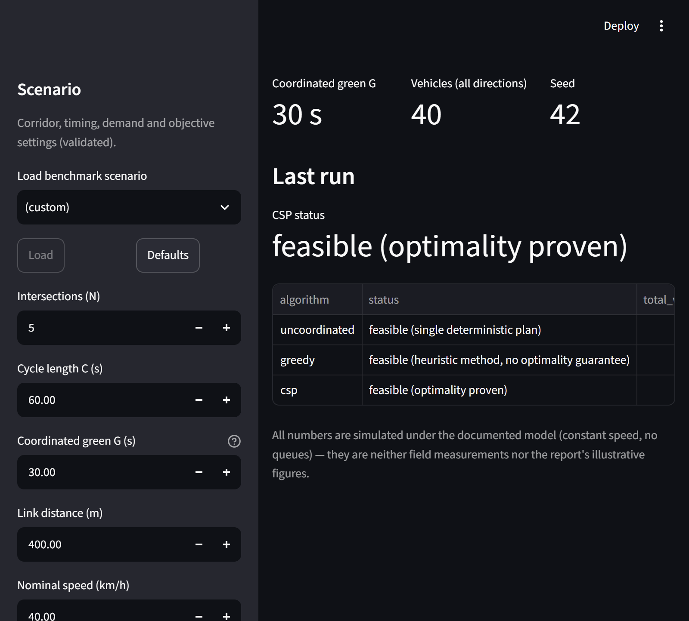
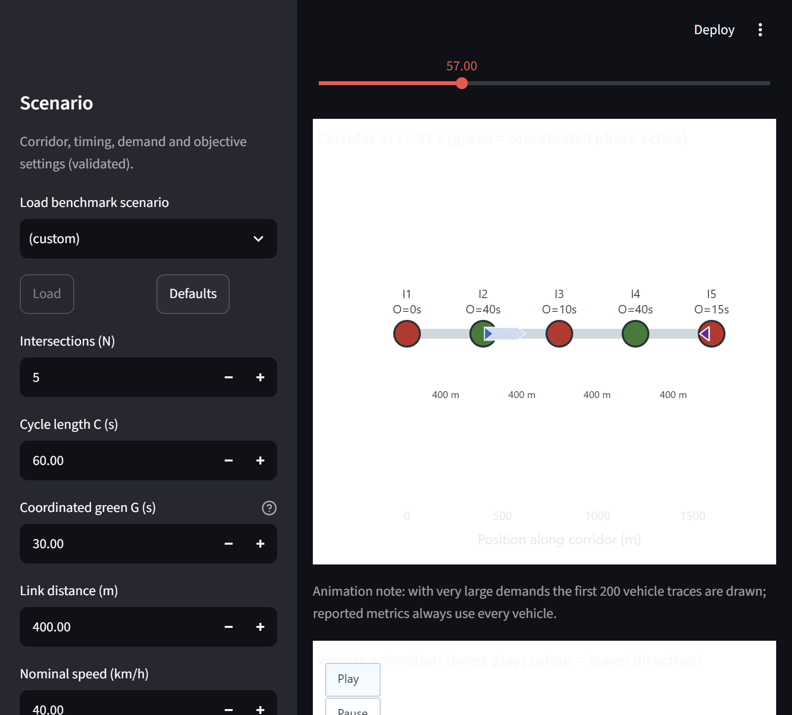
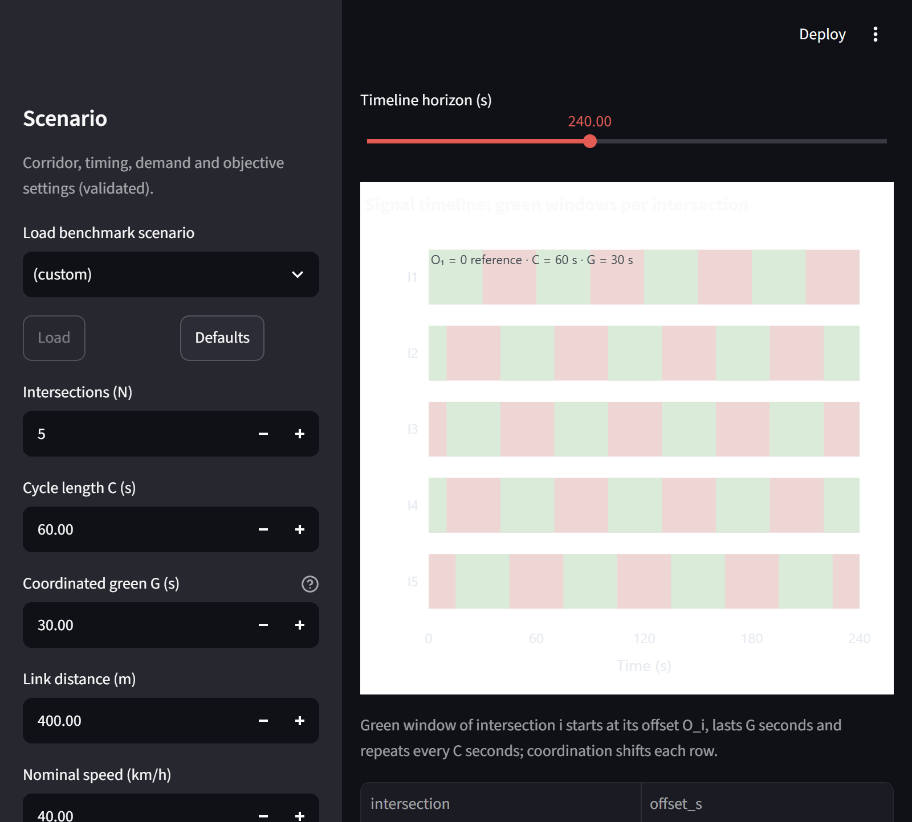
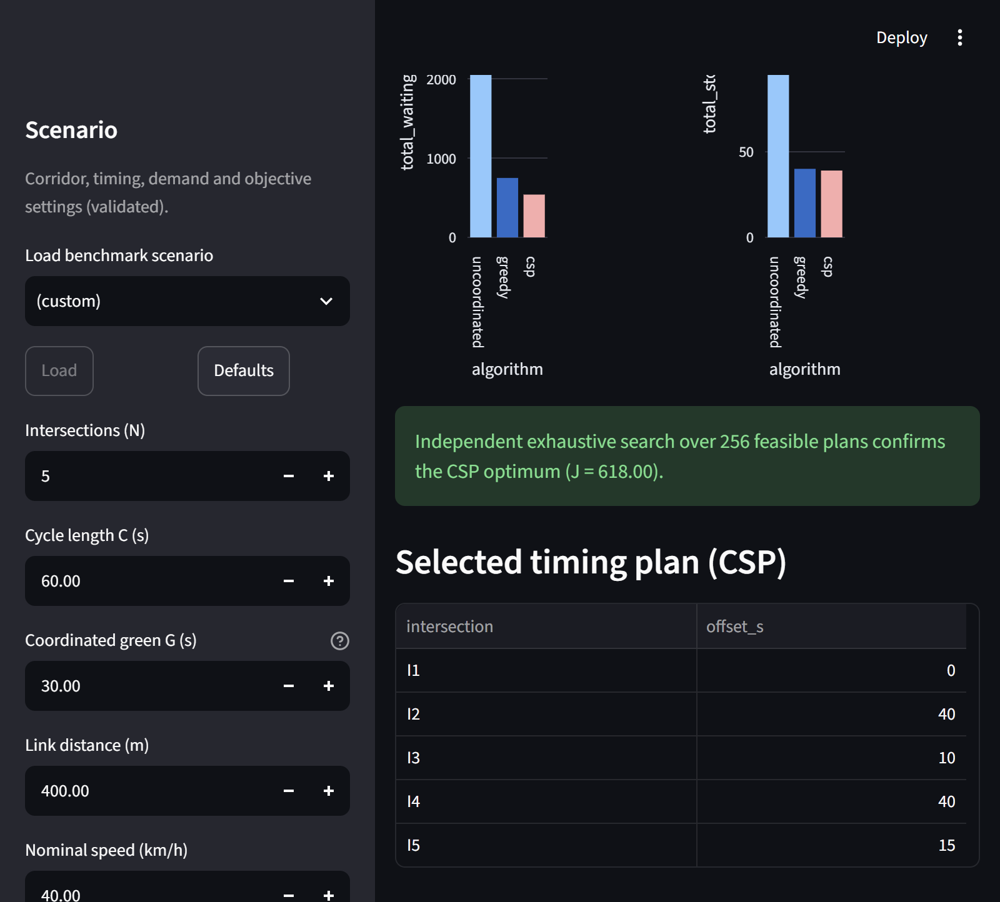
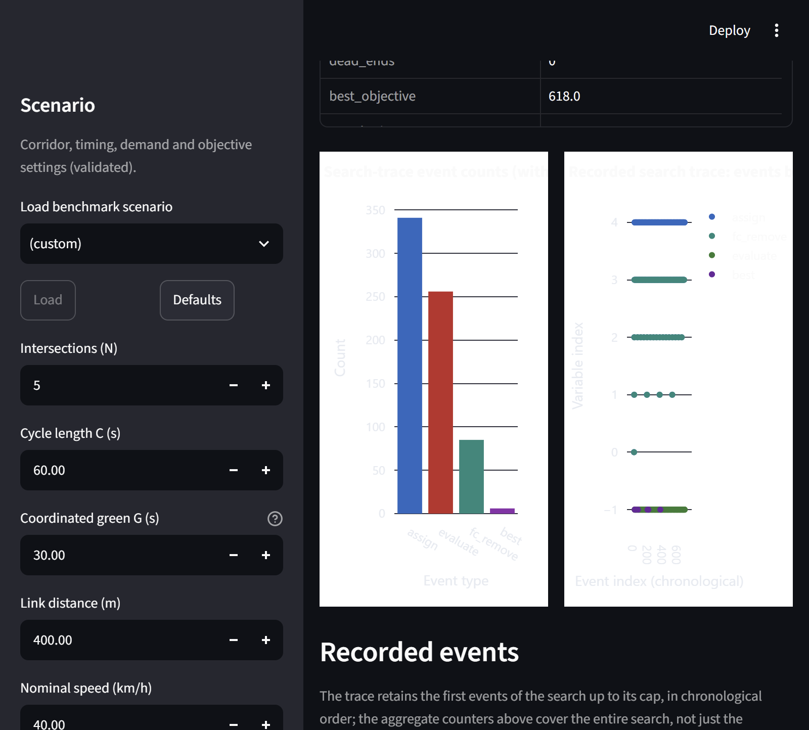
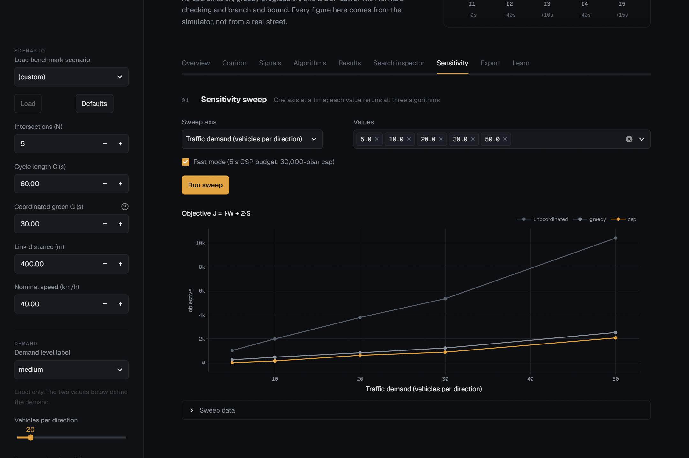

# 🚦 Classical AI-Based Traffic Signal Coordination

[](pyproject.toml)
[](LICENSE)
[](https://docs.astral.sh/ruff/)

An educational simulation and decision-support system for the **ECSCT24301 —
Foundation of AI** project (Applied AI track, Adani University, AY 2026–27).
Coordinates signal offsets along an arterial corridor and compares three
strategies on identical generated traffic with **one shared deterministic
simulator**:

| Strategy | Method | Guarantee reported |
|---|---|---|
| Uncoordinated | no search — all offsets 0 | single deterministic plan |
| Greedy progression | `Oᵢ₊₁ = Oᵢ + τᵢ (mod C)` rounded to the grid | heuristic, no optimality claim |
| CSP optimizer | backtracking + forward checking + branch & bound | *optimality proven* when the search completes, `incomplete` honestly when budgets stop it |

Objective: `J = α·W + β·S` (α=1, β=2 default — one stop costs like two seconds
of waiting). Everything is reproducible: fixed seeds, deterministic evaluation,
one-command benchmarks, and an **independent exhaustive verifier** that
cross-checks the CSP's claimed optimum wherever the search space is small
enough.

> **Honesty statement.** All numbers in this repository are measured in
> simulation under documented simplifying assumptions (constant speeds, no
> queues/capacity, one coordinated green per signal). They are *not* field
> measurements and *not* the textbook's illustrative figures. Skipped or
> incomplete experiments (e.g. exhaustive verification of very large spaces)
> are recorded as such rather than faked.

## Screenshots (captured from a live session, scenario B defaults)

| | |
|---|---|
|  |  |
|  |  |
|  |  |

## Quickstart

```bash
git clone https://github.com/vyeos/fai-project.git
cd fai-project

python -m venv .venv
# Windows:
.venv\Scripts\python -m pip install -e ".[dev]"
# Linux/macOS:
python3 -m pip install -e ".[dev]"

# run the dashboard
python -m streamlit run app.py
```

## Commands

| Task | Command |
|---|---|
| Dashboard (9 tabs) | `python -m streamlit run app.py` |
| Full benchmark suite (A–E + F/G/H/J) | `python -m traffic_coordination.experiments.benchmark_runner --all` |
| Main scenarios only | `... --main` |
| One scenario | `... --scenario B` |
| Sensitivity scenarios only | `... --sensitivity` |
| Test suite (76 tests) | `pytest` |
| Lint | `ruff check src tests app.py tools` |
| Pre-push check (no hosted CI) | `ruff check src tests app.py tools && pytest` |

Benchmark outputs land in `experiments/results/` (CSV, JSON, `summary.md`)
and figures in `experiments/figures/` (fig1–fig8).

## Measured headline results

From `experiments/results/summary.md` (α=1, β=2; see file for all scenarios):

| Scenario | Uncoordinated J | Greedy J | CSP J | CSP improvement | CSP status |
|---|---:|---:|---:|---:|---|
| A (3 ×eq, low) | 762 | 140 | **140** | 81.6% | proven optimal (verified, 144 plans) |
| B (5 ×eq, medium) | 3780 | 830 | **618** | 83.7% | proven optimal (verified, 20,736 plans) |
| C (7 ×eq, ρ=10 s) | 5860 | 1610 | **674** | 88.5% | proven optimal in tolerant space; raw-space verification skipped (2.99M plans) |
| D (5 ×eq, high) | 10406 | 2525 | **2078** | 80.0% | proven optimal (verified, 20,736 plans) |
| E (1 s grid, ρ=10 s) | 3780 | 850 | **605** | 84.0% | proven optimal in tolerant space; raw-space verification skipped (12.96M plans) |

Honest search statistics worth quoting: scenario C's forward checking removed
**10,920** domain values while cutting the evaluated space to 4,096 plans; in
every run the branch-and-bound counter honestly reports **0** prunes because
the implemented bound `h(s) = 0` is admissible but weak.

## Documentation

- [`docs/ARCHITECTURE.md`](docs/ARCHITECTURE.md) — module layout, simulator
  semantics, algorithm detail, verification, data flow, dashboard design.
- [`docs/viva_questions.md`](docs/viva_questions.md) — 42 viva questions with
  answers grounded in measured results.
- [`docs/screenshots/`](docs/screenshots/) — 15 live-verified UI screenshots.
- [`CHANGELOG.md`](CHANGELOG.md) · [`CITATION.cff`](CITATION.cff) ·
  [`CONTRIBUTING.md`](CONTRIBUTING.md)

## The model in one paragraph

N signalized intersections (default 5) on a one-corridor arterial, cycle
C = 60 s, coordinated green G = 30 s, offsets on a 5 s grid. A vehicle moving
at nominal speed reaches the next signal after τ ≈ 36 s; it sees green iff
`((t − Oᵢ) mod C) < G`, stops once per red arrival and waits for the next
green window. Departure patterns (platoon or uniform), demand levels, speed,
direction mode and seeds are all configurable; three algorithms then compete
for the lowest J on exactly the same vehicles.

## License

MIT — see [`LICENSE`](LICENSE).
